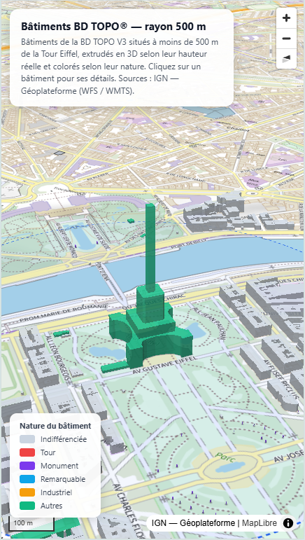

Créer une carte en 3D en quelques prompts? C'est possible grâce au **MCP geocontext** qui connecte votre assistant IA préféré aux données diffusées sur la **Géoplateforme** par l'**IGN** et ses partenaires.

- *Voir la vidéo de démonstration* : lien à venir
- *Voir la carte produite* : https://ignf-act.github.io/tour_eiffel/
- *Documentation* : https://github.com/ignfab/geocontext#readme
- *URL du serveur MCP (beta)* : https://geollm.beta.ign.fr/geocontext/mcp
- *Assistant IA utilisé* : Mistral Vibe (avec compte gratuit)

